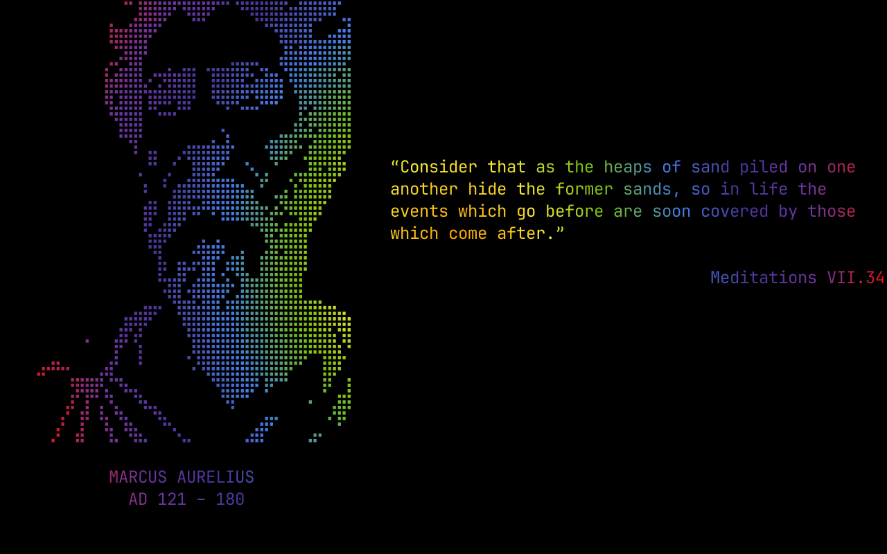
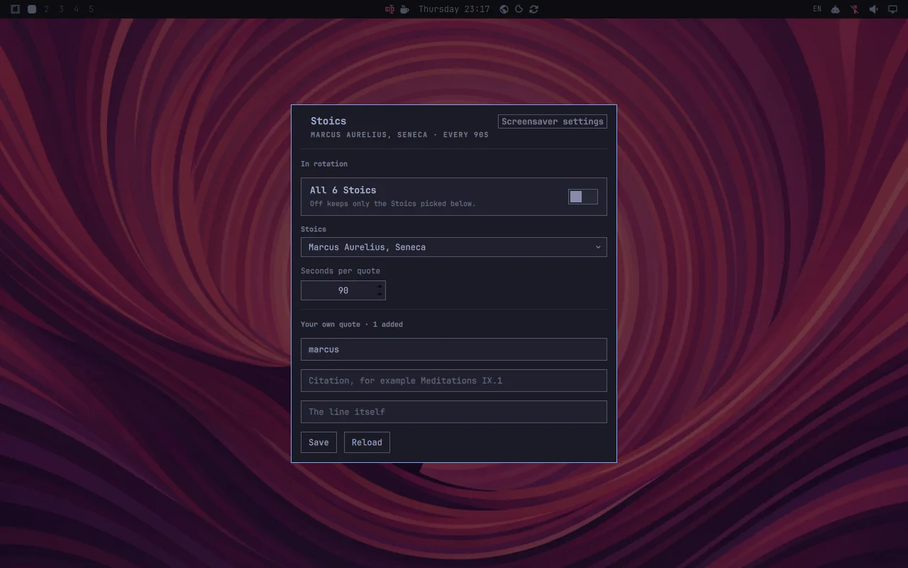
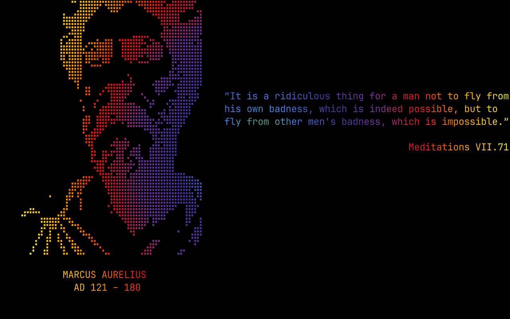
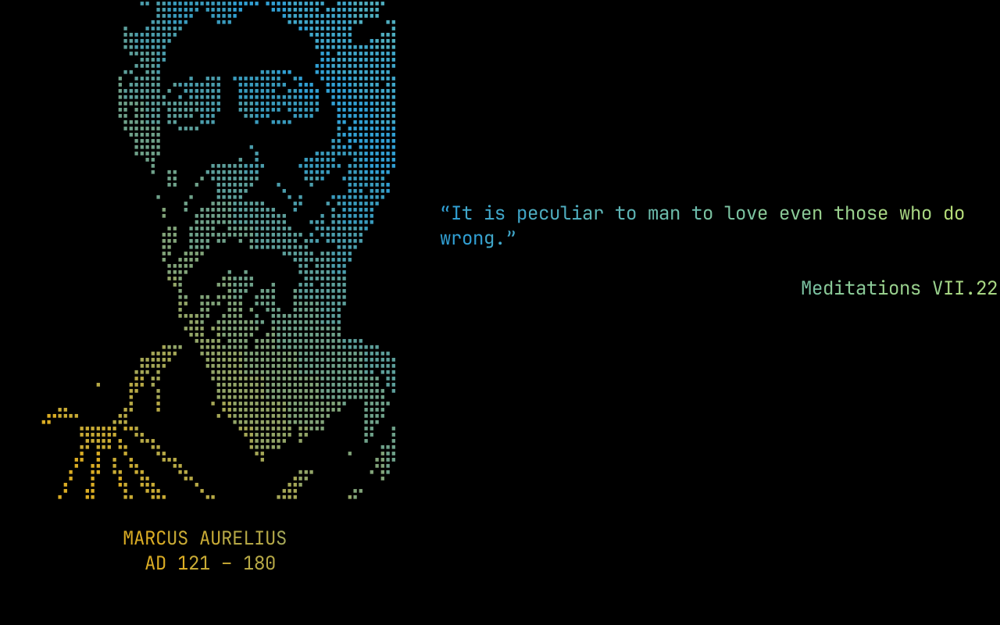
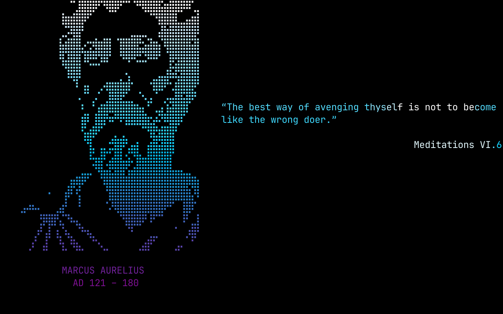

# Omastoic

**The Stoics on your Omarchy screensaver.** One braille portrait, one cited thought.



Live capture, 19 November 2026, on Omarchy dev `d54cde78f` (x86_64),
`omarchy-screensaver` 1.3.1, Tokyo Night, plugin `eae779c`. Colorshift is the
screensaver's effect. The portrait and the quote are the canvas Omastoic wrote.

## Which screensaver

Omastoic writes the file Omarchy already reads,
`~/.config/omarchy/branding/screensaver.txt`. It does not replace the launcher.

**Native (current Omarchy dev).** The package `omarchy-screensaver` (tested at
1.3.1, `omarchy pkg add omarchy-screensaver`) provides
`/usr/lib/omarchy-screensaver/omarchy-screensaver`. That path is not on `PATH`.
`omarchy-launch-screensaver` execs it. Idle and *System → Screensaver* pass no
arguments, so they show the branding file. The program reads its text once, at
start. Omastoic leaves the next quote there and writes a different one when
that process exits. `omastoic preview` is the launch Omastoic does itself: it
passes `--input` pointed at the same file. The quote does not change while the
overlay is up. This path does not need `ttfx`.

**Terminal (older Omarchy).** The saver rereads the branding file between
effects, and the service swaps the quote on your interval while a screensaver
window is open. Audited on Omarchy 4.5.0rc3 against host
`5eb922f137422ff32a90869a9ba47525a428792d`. This path needs `ttfx`
(`omarchy pkg add ttfx`) and does not need `omarchy-screensaver`.

Both need [Bun](https://bun.sh) (tested with 1.4.4, `omarchy pkg add bun`), a
user systemd session, `jq`, and Python 3. Nothing is fetched at runtime.

## Install

```bash
omarchy plugin add https://github.com/rastermanden/omastoic.git --enable
```

`omarchy plugin add` does not install packages. Install Bun first, and either
`omarchy-screensaver` (native) or `ttfx` (terminal).

Enabling runs setup in the existing Omarchy shell. The first successful setup
keeps your current branding, writes a canvas, links the `omastoic` command,
installs completions and user units, and adds one menu row:

**Appearance → Branding → Screensaver → Stoics**

The row turns the Stoics on and off. There is no application launcher and no
Configure row. Text, Image, and Restore Default stay Omarchy's. Old
plugin-owned `style.screensaver.*` rows move only inside our marked block.

Defaults are all six Stoics and 60 seconds per quote. On the native saver that
number is stored and not applied: each start shows one quote, and the next
start shows another. On the terminal saver the service holds each canvas for
that many seconds while the saver is up. `ttfx` rereads at its next effect, so
the wait is not a promise of that many uninterrupted seconds.

A failed setup returns non-zero and writes no install marker. Fix the command
it names, then run `omastoic setup`. Setup does not turn the Stoics back on
after `off` or after the plugin is disabled.

From a checkout, `./install.sh` checks those dependencies (and `rsync`) and
copies into the plugins directory. The copy is not a Git checkout: update the
source and run `./install.sh` again. `omarchy plugin update` only updates
Git-managed installs. The copy refuses a linked plugin, a Git checkout, or an
unrelated directory. Coming from the 1.x id `omastoic`, remove that plugin
before adding this one.

## Update

```bash
omarchy plugin update io.github.rastermanden.omastoic
```

`~/.config/omastoic/` sits outside the plugin tree, so an update does not
replace `config.json` or `quotes.tsv`. A live upgrade from `2c9a0e9` kept both.

## Use

```bash
omastoic toggle                 # Stoics on, or give the slot back
omastoic next                   # another quote, only while we still own it
omastoic preview                # select Stoics if needed, and start the saver
omastoic show --cols 92 --rows 25
omastoic status
omastoic config                 # Stoics, quotes, seconds, and one of your own
omastoic config --plain         # numbered prompts instead of keys
omastoic ui                     # the same settings in a Quickshell panel
omastoic --help                 # help, and nothing else
```

`--help` and `-h` do that for every command, including `omastoic uninstall --help`.

Omarchy's branding commands win. Edit Text, Set From Image, and Restore
Default hand the slot back, including while idle. Choose Stoics again to opt
back in.

Disabling the plugin stops and disables its user service, and restores
branding only when the canvas is still ours. Reloading QML is not a disable.

### Settings

`omastoic ui` opens the panel in a running Omarchy shell. The same choices are
`omastoic config`.



`~/.config/omastoic/config.json` (or `$XDG_CONFIG_HOME/omastoic/`):

```json
{
  "interval": 60,
  "authors": ["marcus", "seneca"],
  "quotes": { "marcus": ["q01", "q04"] }
}
```

`interval` is a whole number of seconds from 1 to 3600. Leave out `authors`
for all six. `quotes` limits bundled lines per Stoic. Ids are `q01`, `q02`, …
in `data/quotes.tsv` order (`omastoic config --list`). A missing Stoic means
every bundled line of theirs. An empty list means none of them. Listing every
id is stored as the default and the key is dropped.

```bash
omastoic config --authors marcus,seneca --interval 90
omastoic config --quotes marcus=q01,q02
omastoic config --quotes marcus=all
```

In a terminal the pickers are checklists. Space, `x`, or Tab toggles the
focused row. `1`–`9` toggle the numbered row on screen. Arrows or `j`/`k`
move. `/` filters quotes. `a` selects the rows on screen, `n` clears them,
Enter saves, and `q`, Esc, or Ctrl-C cancels. `--plain`, a pipe, or a terminal
that cannot go raw asks for numbers, ids, `all`, `none`, or an empty line to
keep the current set.

### Your own quotes

`omastoic config --add` appends to `~/.config/omastoic/quotes.tsv`. It asks for
a slug, a citation, and the text. A script can pass one tab-separated line:

```bash
omastoic config --add $'marcus\tMeditations IX.1\tYour line.'
```

A slug is lowercase letters, digits, `_`, or `-`, at most 64 characters.
Citations stop at 256 characters, quote text at 4096, and the file at 1 MiB.
Terminal control escapes are rejected. Custom lines are `c01`, `c02`, … in
file order. A bundled-only id list still keeps them until you uncheck them
(`c00` clears every custom line for that Stoic). An unknown author has no
portrait. The file is never inside the plugin checkout.

### On screen

The canvas uses the smallest measured terminal or monitor. Portraits drop out
when they cannot fit. In a 20×8 reading area, a quote that cannot fit whole
shows “Resize to read quote” and its citation, never a cut sentence. The
portraits are AI-imagined illustrations, not photographs.
[docs/ART.md](docs/ART.md) is how they were made.
[CREDITS.md](CREDITS.md) names the translations.

### Other native effects

Same kind of canvas, other effects from that `omarchy-screensaver` 1.3.1
session. Captured with the plugin at `eae779c`.







## Remove

```bash
omastoic uninstall
omarchy plugin remove io.github.rastermanden.omastoic
```

Both stop and disable the user service, restore branding when it is still
ours, and remove the menu block, the `omastoic` link, completions, user units,
and the prune script. `omastoic uninstall` also asks Omarchy to remove the
plugin. Removing it from Omarchy runs the same cleanup.

Kept on purpose: `~/.config/omastoic/` (`config.json` and `quotes.tsv`).
`omastoic uninstall --purge` deletes that directory too.

Also removed: the other files under `~/.local/state/omastoic/` (`cell.json`,
`launch.err`, `recent.json`, `owned/`) and an empty `~/.local/lib/omastoic/`.
`transaction.flock` can remain. It is the lock that uninstall holds until the
process exits. A launcher, completion, unit, or piece of art that is not ours
is left alone and reported instead of overwritten.

A partial setup can be retried or removed with the same commands, or with
`./uninstall.sh` from a checkout.

## If something fails

- `no screensaver backend` means the package for this machine is missing.
  Current dev: `omarchy pkg add omarchy-screensaver`. Older terminal saver:
  `omarchy pkg add ttfx`.
- Do not run a command named `omarchy-screensaver`. The program is
  `/usr/lib/omarchy-screensaver/omarchy-screensaver`, and Omarchy starts it
  through `omarchy-launch-screensaver`. Use idle, *System → Screensaver*, or
  `omastoic preview`.
- `omastoic preview` while a native saver is already up does not restart it.
  The canvas just written is what the next start reads.
- Setup prints the missing command and leaves no install marker. Install that
  command, then `omastoic setup`.
- `omastoic ui` needs `omarchy-shell` running. If it is not, the command prints
  the toggle to run once the shell is up.

## Tests

```bash
./tests/run
```

That runs the Bun suite, including the QML lint (skipped when this machine has
no host kit or `qmllint`), then `bash -n` on the shell scripts. When `omarchy`
is on `PATH` it also runs `omarchy plugin validate`.

The suite needs Omarchy's menu parser and branding reset. On a desktop those
come from `/usr/share/omarchy`. Elsewhere set `OMARCHY_TEST_ROOT` to host
revision `5eb922f137422ff32a90869a9ba47525a428792d`. GitHub Actions uses that
pin, Bun 1.4.4, a sandbox home, `./tests/run`, and `omarchy plugin validate`
on a `git archive` of HEAD. The suite does not launch a real saver or change
an installed desktop. One test runs
`/usr/lib/omarchy-screensaver/omarchy-screensaver --headless` when that file
exists. It does not call the bare name.

Release preflight is
[build-omarchy-plugins](https://github.com/tcballard/build-omarchy-plugins) at
`edc72aa3b3762e20ca543df8b472ba1a3b7f52c7`, kept outside this checkout.
`omarchy plugin add` clones every tracked file.

MIT license. Translations and portraits: [CREDITS.md](CREDITS.md).
History: [CHANGELOG.md](CHANGELOG.md).
Vulnerabilities: [SECURITY.md](SECURITY.md).
